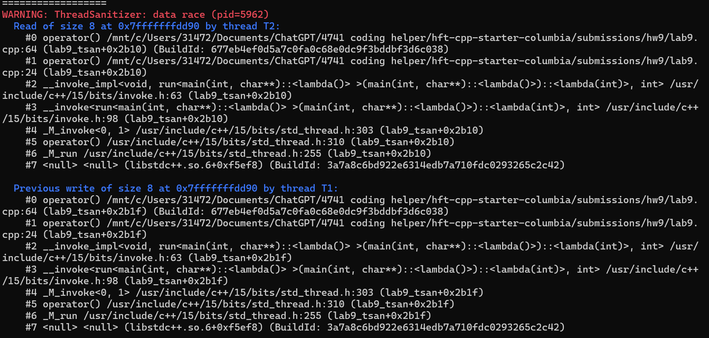
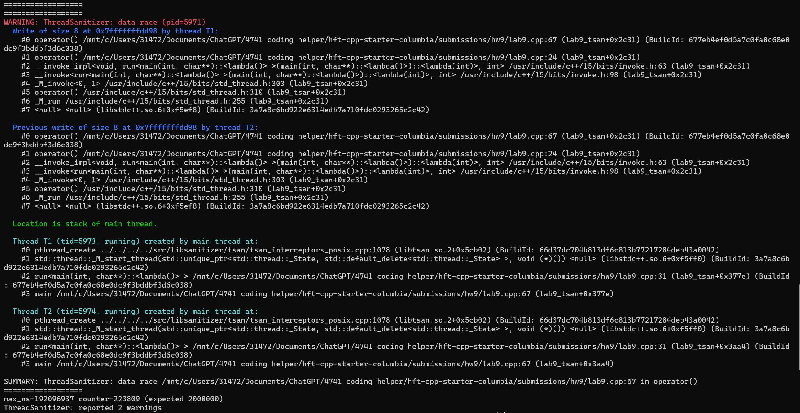
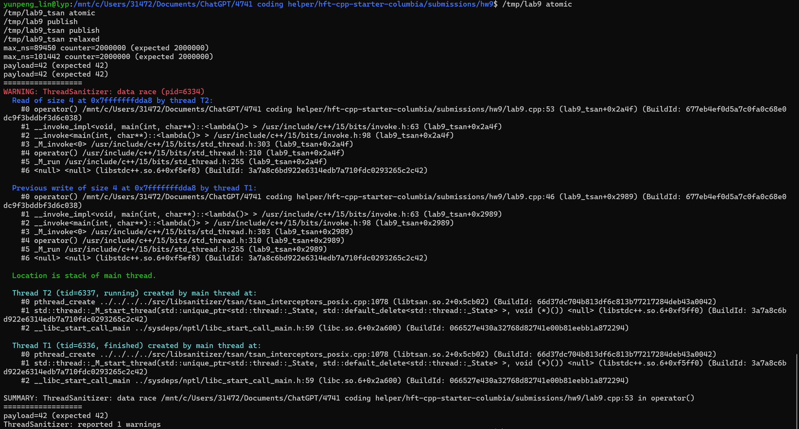

# HW9 — Single-writer seqlock quote publication

`hw9.cpp` contains `SeqLock<T>`, a `std::shared_mutex` baseline, and a driver
that checks correctness and measures reader cycles/op with a live writer.
`lab9.cpp` contains the Week 9 counter and publication experiments.

## Build and run (x86-64 Linux / WSL)

Run from this directory:

```bash
g++ -std=c++17 -O2 -pthread hw9.cpp -o /tmp/hw9
/tmp/hw9
g++ -std=c++17 -O1 -g -pthread -fsanitize=thread hw9.cpp -o /tmp/hw9_tsan
/tmp/hw9_tsan --check
```

`--check` uses a short correctness workload. TSan timing is excluded from the
performance results. GCC emits a compile-time warning that TSan does not support
`atomic_thread_fence`; the submitted safe implementation has atomic payload
bytes and produced no runtime data-race warning.

## Implementation and correctness

There is exactly one writer and four readers. The writer marks the sequence
odd, executes a release fence, stores the payload bytes atomically, and publishes
an even sequence with release ordering. A reader first loads the sequence with
acquire ordering, rejects an odd value, copies the atomic bytes, executes an
acquire fence, and accepts only if the final sequence matches the first.
`read(out)` makes one attempt; false leaves `out` unchanged and the caller
retries. Successful readers return a complete snapshot without acquiring a lock.

For generation n, the test writes `bid=n, ask=n+1, bq=n, aq=n+1` and checks
all four fields on every accepted read. All 15 performance runs had `mixed=0`:
12,000,000 accepted reads in total. The short normal and TSan runs also passed
with `mixed=0` for all three versions.

The initial acquire load observes the release publication of a completed
generation, preventing older payload values. If any payload byte is read from a
later write, that atomic store/load connects the writer's release fence to the
reader's acquire fence. The later odd sequence store then happens-before final
validation, so validation cannot accept the earlier even sequence. This rules
out mixed accepted snapshots. Assumptions: a single writer, trivially copyable
T, private input/output objects, construction before sharing, no destruction
during access, and no sequence wraparound during one attempt. Lock-free byte
and 64-bit atomics are enforced at compile time. Continuous writes may make a
reader retry indefinitely; successful reads are not guaranteed to be wait-free.

## Measured reader cycles/op

Measured locally on WSL2 x86-64, AMD Ryzen 9 9955HX, GCC 15.2.0, 2026-10-31.
One unpaced writer, four readers, 1,000 warmup reads/reader, then 200,000
successful reads/reader/run. Five runs per version; the table reports the
terminal measurements supplied with this submission.

| Run | Before: seq_cst | After: release/acquire + fences | shared_mutex |
|---|---:|---:|---:|
| 1 | 3565.408 | 331.137 | 1333.519 |
| 2 | 3994.082 | 346.147 | 1129.981 |
| 3 | 3828.350 | 387.938 | 940.608 |
| 4 | 3295.123 | 311.587 | 1366.797 |
| 5 | 4189.891 | 276.960 | 1035.964 |
| **Median** | **3828.350** | **331.137** | **1129.981** |

One op is one successful read, including retries, field checks and a local
checksum. Cycles/op is the sum of reader TSC deltas divided by total accepted
reads. These are invariant **TSC reference ticks**, not PMU core-cycle counts.
No CPU affinity was used. The writer is unpaced and its achieved update rate
differs between versions; the results describe this workload, not equal-rate
publication. Each run prints writer progress and retry counts.

**The single change that helped most:** I replaced the conservative seq_cst
ordering policy with release/acquire publication, a release/acquire fence pair,
and relaxed atomic payload accesses. Data layout and the reader workload stayed
the same. This removes unnecessary ordering from the writer's atomic byte
stores and reduces reader retries. Median reader cost fell from 3828.350 to
331.137 TSC ticks/op, an 11.56x ratio (91.35% reduction). The shared_mutex
baseline took 1129.981 ticks/op, 3.41x the optimized reader cost. These ratios
apply to the measured continuous-writer workload on this machine.

## Why a conventional seqlock trips ThreadSanitizer

A conventional implementation copies an ordinary shared T while the writer may
modify it. That is a C++ data race and undefined behavior; rejecting the copy
afterward cannot undo it. It must not simply be dismissed as a TSan false
positive. This implementation instead accesses every shared payload byte
atomically. The sequence/fence argument above establishes snapshot consistency;
a clean TSan run alone cannot prove that protocol. GCC's fence-instrumentation
limitation is another reason to keep the reasoning separate from tool results.

## Week 9 lab evidence

```bash
g++ -std=c++17 -O2 -pthread lab9.cpp -o /tmp/lab9
g++ -std=c++17 -O1 -g -pthread -fsanitize=thread lab9.cpp -o /tmp/lab9_tsan
/tmp/lab9_tsan race
/tmp/lab9_tsan volatile
/tmp/lab9_tsan atomic
/tmp/lab9_tsan publish
/tmp/lab9_tsan relaxed
/tmp/lab9 atomic
/tmp/lab9 mutex
/tmp/lab9_tsan mutex
```

- Ordinary and volatile counters: TSan reported data races (screenshots below).
- Atomic counter: 2,000,000, no runtime TSan race warning. Relaxed `fetch_add`
  suffices because the counter publishes no other data.
- Release/acquire publication: payload 42, no runtime TSan race warning.
- Both sides changed to relaxed: payload still printed 42, but TSan reported
  a race. Atomic ready alone creates no happens-before edge for plain payload.
  This is a one-time publication, not a reusable-buffer protocol.
- Atomic max latency: **105,531 ns**; mutex max latency: **205,029 ns**, with
  both totals equal to 2,000,000. The TSan mutex run also returned 2,000,000
  (max 536,728 ns, excluded from the performance comparison). Samples include
  clock overhead and scheduler delays; these maxima are not hard bounds.

Mutex contention can block a thread and require a scheduler wakeup, producing
tail jitter relevant to p99.9 even when average latency looks acceptable.

<details>
<summary>Submitted TSan screenshots</summary>

Ordinary counter race:



Volatile counter race:



Atomic and release/acquire runs, followed by the deliberately broken relaxed publication:



</details>

